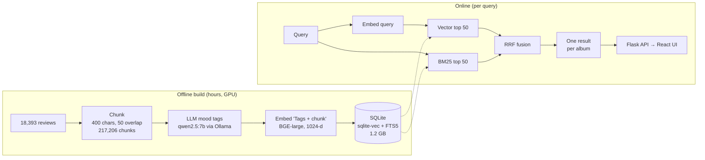

# Semantic Grooves

### Discover music by how it feels, not by what it's called.

> *"music for a long drive home after a breakup"*
> &rarr; Ryan Adams, *Heartbreaker* &middot; Brendan Benson, *The Alternative to Love* &middot; The Weight, *Are Men*

A semantic search engine over **18,393 Pitchfork album reviews**. You describe a mood in plain language; it finds the records critics described that way, whatever their genre.

This README is a technical pitch: the idea first, then the machinery. Each section is one slide.

---

## 1 &middot; The problem

Music discovery is organised around **genre** and **"fans also like"**.

- Genres are marketing categories, not feelings. A quiet Sunday morning is *folk* for one record, *ambient* for the next and *house* for a third.
- "If you like X" recommendations only work if you already know an X.
- People don't think in taxonomies. They say *"something warm and unhurried"* or *"angry but not aggressive"*.

Nothing in a genre tag tells you what it feels like to listen to the record.

---

## 2 &middot; The idea

**Search by mood. Let the vocabulary of critics do the matching.**

Critics already describe records in terms of experience: exhaustion, longing, tension, release. We embed that prose, so a query is matched on meaning, not on genre labels or keywords.

Real output, first run, unfiltered (RRF score &middot; album &middot; Pitchfork score &middot; generated tags, abbreviated):

**"music for a long drive home after a breakup"**

| RRF | Album | Pitchfork | Tags |
|---|---|---|---|
| 0.0476 | Wild Sweet Orange &ndash; *We Have Cause to Be Uneasy* | 5.7 | Exhaustion, Comfort, Piano, Indie Rock, Emotional Release |
| 0.0455 | Ryan Adams &ndash; *Heartbreaker* | 9.0 | Sadness, Loneliness, Reflection, Violin, Breakup Music |
| 0.0435 | Brendan Benson &ndash; *The Alternative to Love* | 7.2 | Sadness, Longing, Piano, Soft Rock, Emotional Distress |
| 0.0417 | The Weight &ndash; *Are Men* | 4.9 | Sadness, Loneliness, Guitar, Country, Folk, Nostalgia |

**"the feeling of a quiet Sunday morning, warm and unhurried"**

| RRF | Album | Pitchfork | Tags |
|---|---|---|---|
| 0.0476 | Julie Doiron &ndash; *Heart and Crime* | 7.6 | calmness, serenity, guitar, folk, minimalism |
| 0.0455 | Sachiko M, Otomo Yoshihide, Toshimaru Nakamura &ndash; *Good Morning Good Night* | 7.3 | peacefulness, tranquility, ambient, experimental |
| 0.0435 | Blue Daisy &ndash; *The Sunday Gift* | 7.5 | Emotional, Relaxing, Wistful, Cinematic, House |
| 0.0417 | The Innocence Mission &ndash; *Befriended* | 7.6 | bucolic, wistfulness, acoustic guitars, organ |

Look at the second query. Folk, ambient/experimental and house land side by side because they share a feeling. A genre filter could never produce that list.

---

## 3 &middot; Why reviews

| | |
|---|---|
| **Corpus** | [Pitchfork reviews, Kaggle](https://www.kaggle.com/datasets/nolanbconaway/pitchfork-data): 18,393 reviews, 1999&ndash;2017, mean score 7.01 |
| **Why it works** | Review prose is dense with emotional and sensory language: the raw material for mood search |
| **Why it's a PoC** | One publication, one era, one editorial taste. Mood coverage is only as broad as what Pitchfork wrote about |

---

## 4 &middot; Architecture



The expensive work happens once, offline. Serving a query is one embedding plus two SQLite lookups.

---

## 5 &middot; Technical choice 1: chunk, then tag moods

**Chunking.** A review's mood shifts: a brooding opening, a euphoric closer. One embedding per review averages that away. Each review is split into **400-character chunks with 50 characters of overlap** (about 12 chunks per review, 389 characters on average), and each chunk is searchable on its own.

**LLM mood tags.** Every chunk is summarised by a local LLM (`qwen2.5:7b`, temperature 0) into a comma-separated list of *emotions, feelings, instruments, genres and effects*:

```
Excitement, Intrigue, Intensity, Complexity, Energy, Passion, Speed, Innovation, Dissonance, Metal, Post-Metal, Black Metal
Serene, Mysterious, Sparse, Acoustic, Ambient, Electronic, Minimalist
```

**Embedding input** is `"Tags: {tags}\nReview: {chunk}"`. The tags act as a mood-dense prefix that pulls the vector toward feeling, while the raw text keeps the specifics.

Genres still appear in the tags as one descriptor among many. The point is that the *query* never needs one.

---

## 6 &middot; Technical choice 2: hybrid retrieval

Two retrievers run against the same chunk table. Each returns 50 candidates.

| Retriever | Strength | Implementation |
|---|---|---|
| **Vector** | Meaning: *"heartbreak"* matches *"loneliness"* | [`sqlite-vec`](https://github.com/asg017/sqlite-vec) `vec0`, BGE-large (`BAAI/bge-large-en-v1.5`), 1024-d, L2-normalised |
| **Lexical** | Exact terms: names, instruments, rare words | SQLite **FTS5**, BM25 ranking, over tags and chunk text |

Vectors are normalised, so distance ranks the same as cosine. The `vec0` search is an **exact brute-force scan**, not approximate nearest neighbour. That is fine at 217k vectors and one reason the whole system fits in one file.

---

## 7 &middot; Technical choice 3: Reciprocal Rank Fusion

Vector distances and BM25 scores live on incompatible scales, so we **fuse ranks, not scores**:

```
score(chunk) = sum over retrievers of  1 / (k + rank + 1)        k = 20, rank is 0-based
```

- A chunk found by both retrievers adds two terms, so agreement is rewarded.
- **Higher is better.** The maximum possible score is `2 / (k + 1)` (rank 1 in both lists): `0.0952` at `k = 20`.
- Ties break on chunk id, so results are deterministic.
- Needs no training and no score calibration, and `k` is the only knob.

**One result per album.** Several chunks of the same review often match. After fusion we keep each album's best chunk, then take the top N albums. Without this a single review can fill half of the first page.

---

## 8 &middot; Technical choice 4: one SQLite file

No vector database service. The review metadata, the tags, the 1024-d vectors and the full-text index all live in one SQLite file loaded with the `sqlite-vec` extension.

- **For:** zero infrastructure, trivially copyable, joins between vectors and metadata are plain SQL.
- **Against:** brute-force vector scan won't scale to many millions of chunks, and the 1.2 GB file has to be shipped with the app.

---

## 9 &middot; Next: MMR reranking *(not implemented yet)*

Status: **planned.** Nothing in the code does this today.

Mood queries tend to return near-identical records: five sad-piano albums in a row. Our per-album dedupe only removes repeats of the *same* album. **Maximal Marginal Relevance** would diversify across albums:

```
MMR = argmax over unselected d of   lambda * sim(d, query)  -  (1 - lambda) * max sim(d, already_selected)
```

- Applied to the top ~50 results after RRF, using the stored vectors.
- `lambda` trades relevance (1.0) against variety (0.0). A starting value around 0.7 is a guess to be tuned.
- It is a different job from RRF: RRF **merges** two rankings, MMR **re-orders** one to reduce redundancy. They are complementary.

---

## 10 &middot; Performance

Measured on the author's machine (AMD Radeon GPU via ROCm, 16 CPU cores):

| | |
|---|---|
| Warm query, end to end (GPU) | about **0.65 s** |
| Cold start (loading BGE-large) | about 23 s |
| Database | 1.2 GB, 217,206 chunks |

CPU-only latency has not been measured. There is **no relevance evaluation yet**: no labelled queries, no precision numbers. The demo tables above are a first impression, not a benchmark.

---

## 11 &middot; Known limitations

Found while writing this deck, so they are documented rather than hidden:

1. **The lexical half is mostly idle for natural-language queries.** FTS5 requires *every* term to match, so a sentence-length query gets zero lexical hits (*"music for a long drive home after a breakup"*: 0 hits; *"sadness loneliness piano"*: 194). For those queries the engine is effectively vector-only.
2. **Commas break the lexical query.** *"quiet Sunday morning, warm and unhurried"* raises an FTS5 syntax error and silently falls back to vector-only.
3. **No MMR yet**, so results can be repetitive (slide 9).
4. **No evaluation set** (slide 10).
5. **Corpus bias:** Pitchfork only, 1999&ndash;2017.
6. **Tags are LLM-generated** and not human-verified; some are noise.
7. **Setup is manual:** the build needs Ollama and a GPU, scripts use paths relative to `search_engine/`, and `npm run build` currently fails on a type error in `components/ui/calendar.tsx` (`npm run dev` works).

---

## 12 &middot; Try it

**Stack:** Python 3.12, Flask, sentence-transformers, sqlite-vec, SQLite FTS5, Ollama; React 19 + TypeScript + Vite + Tailwind.

**Serve** (needs a prepared `database.sqlite` in the repo root):

```bash
pip install -r requirements-api.txt
python api.py                       # http://localhost:5000

cd frontend && npm install && npm run dev   # http://localhost:3000
```

**Build the database from scratch** (hours; needs [Ollama](https://ollama.com) with `qwen2.5:7b`, and a GPU is strongly recommended):

```bash
python setup.py                     # downloads the Kaggle dataset into ./db
cd search_engine
python preparedb.v2.py              # chunk + LLM mood tags -> review_tags
python embedder.v2.py               # embeddings + FTS5 index
```

**Test** (no database or model needed; tests use a tiny fixture):

```bash
pip install -r requirements-dev.txt
pytest
```

**API**

```http
POST /api/search
{ "query": "warm and unhurried", "top_n": 20, "k": 20 }
```

```json
{ "results": [ { "reviewid": "...", "artist": "...", "title": "...", "score": 7.6,
                 "url": "http://pitchfork.com/reviews/albums/...", "tags": "...", "relevance": 0.0476 } ] }
```

`top_n` is 1&ndash;100, `k` is the RRF constant (1&ndash;1000), and `relevance` is the RRF score of the album's best chunk (higher is better).

---

## Repo map

```
api.py                     Flask API: hybrid search, RRF, per-album dedupe
search_engine/
  preparedb.v2.py          chunk reviews + generate mood tags (Ollama)
  embedder.v2.py           embed chunks, build vector + FTS5 tables
  search.py                standalone CLI search (broken: points at the empty db/database.sqlite)
frontend/                  React + Vite UI
tests/                     pytest suite (fixture DB, stub embedder)
v1/                        legacy scripts (deprecated)
```
